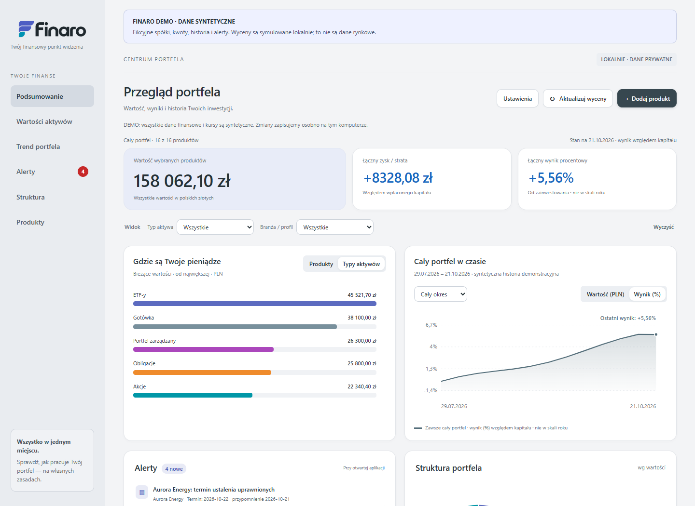

# Finaro demo

**Wartość, wynik i historia Twojego portfela w jednym miejscu.**

Lokalna aplikacja dla Windows 10/11 do przeglądania inwestycji z różnych rachunków.

*Widok demonstracyjny. Wszystkie produkty, kwoty, kursy i historia na zrzucie są fikcyjne.*

[Repozytorium GitHub](https://github.com/panbojek/finaro) · [Pobierz projekt](https://github.com/panbojek/finaro/archive/refs/heads/main.zip) · [Zgłoś problem](https://github.com/panbojek/finaro/issues)

**Wersja 1.0.13** · [Numeracja i wydania](docs/WYDANIA.md)

**Lokalny przegląd portfela inwestycyjnego dla Windows 10/11.** Obecna wersja nie działa na macOS ani Linuxie.

Wszystkie spółki, rachunki, kwoty, ceny, historia i alerty w tej edycji są fikcyjne. Możesz obejrzeć działające demo, a potem z pomocą Claude Code dostosować swoją wersję programu do własnych inwestycji. Do obejrzenia demo nie potrzebujesz konta maklerskiego ani klucza do notowań.

Finaro demo nie stanowi doradztwa inwestycyjnego ani rekomendacji kupna lub sprzedaży instrumentów finansowych. Dane dostarczone z demo są fikcyjne i służą wyłącznie demonstracji działania aplikacji.

## 1. Uruchom

Korzystasz już z Claude Code? Przejdź do [jednej instrukcji startowej z poleceniem do skopiowania](docs/URUCHOMIENIE-Z-AI.md). Znajdziesz tam wybór folderu, uruchomienie i sposób kontynuowania pracy. ChatGPT/Codex z lokalnymi narzędziami jest alternatywą. Możesz także skorzystać z [instalacji bez AI](docs/INSTALACJA.md).

## 2. Poznaj demo

Po uruchomieniu otwórz **http://127.0.0.1:47832**. Zobaczysz baner **DEMO · DANE SYNTETYCZNE**.

Finaro pokazuje wartość portfela, zysk lub stratę i wynik procentowy względem kapitału. Pozwala:

- oglądać historię, słupki wartości i strukturę portfela na wykresie kołowym;
- filtrować produkty według typu i branży oraz wybierać okres historii;
- prowadzić osobne pozycje na różnych rachunkach, również IKE;
- dodawać i edytować produkty, wyceniać je ręcznie oraz usuwać po potwierdzeniu;
- zobaczyć monit po 14 dniach bez ręcznej wyceny;
- przeglądać przykładowe alerty raportowe, dywidendowe i cenowe;
- eksportować zestawienie do analizy oraz odtwarzać kopie zapasowe danych.

[Spacer po aplikacji i ekrany](docs/INSTRUKCJA.md). Do kolejnych uruchomień wystarczy dwuklik w **kod/Uruchom-Finaro.cmd**. Zakończenie: **Ustawienia → Zakończ Finaro**.

## 3. Przygotuj własny portfel

[Przewodnik „Od demo do własnego portfela”](docs/WLASNY-PORTFEL.md) prowadzi przez dostosowanie programu przez Claude Code, zabezpieczenie poprzedniej wersji i test jednej pozycji.

**To wymaga zmiany programu.** Samo usunięcie przykładowych produktów nie podłącza prawdziwych cen. Nie dodajemy ekranu wyboru Demo / Mój portfel. Najpierw asystent przygotowuje Twoją wersję programu na fikcyjnych danych testowych; prawdziwe pozycje wpisujesz samodzielnie dopiero po sprawdzeniu.

[EODHD](https://eodhd.com/) to zewnętrzny dostawca cen akcji i ETF-ów. Po dodaniu połączenia może aktualizować wycenę rzeczywistych inwestycji. Ma darmowy plan, który może wystarczyć przy małym portfelu i aktualizacji raz dziennie. **Obecne demo nie łączy się z EODHD i nie przyjmuje jego klucza.** [Warunki planu i sposób wykorzystania](docs/EODHD.md).

## Czego ta edycja nie robi

- Nie pobiera prawdziwych cen ani wiadomości. **Aktualizuj wyceny** uruchamia lokalną symulację; kursy walut i historia początkowa również są przykładowe.
- Nie loguje się do banku lub brokera i nie wykrywa zakupów ani sprzedaży.
- Nie prowadzi rejestru transakcji i wpłat, nie ma przycisku Dokup, nie rozlicza podatków ani otrzymanych dywidend.
- Nie liczy wyniku z uwzględnieniem terminów wpłat i wypłat. Wynik to (wartość − kapitał) / kapitał; nie jest to stopa roczna.
- Nie działa jako usługa online i nie zapewnia przenoszenia zaszyfrowanych danych między komputerami.

## Dane i cofanie pomyłek

Zmiany są zapisywane poza folderem programu, w **%LOCALAPPDATA%\FinaroDemo\demo-v1**, z ochroną przypisaną do konta Windows. Pozostają po zamknięciu aplikacji.

**Ustawienia → Pokaż kopie do odtworzenia** pozwala przywrócić cały wcześniejszy stan danych po potwierdzeniu. Nie cofa zmian w kodzie programu. Kopie wymagają tego samego profilu Windows i nie chronią przed utratą urządzenia. [Przywracanie krok po kroku](docs/KOPIE-ZAPASOWE.md) · [Prywatność](docs/PRYWATNOSC.md).

## Gdy potrzebujesz pomocy

[Problemy i powrót po nieudanym dostosowaniu](docs/PROBLEMY.md). Nie wysyłaj kluczy ani rzeczywistych danych finansowych do rozmowy z AI lub zgłoszenia błędu.

Proste wyjaśnienia pojęć: [krótki słowniczek](docs/SLOWNICZEK.md).

## Materiały dodatkowe

Dla osób rozwijających projekt: [mapa kodu i testy](docs/ROZWOJ.md), [zakres wykonanych sprawdzeń](docs/VALIDATION.md), [dane przykładowe](demo/README.md), [współtworzenie](CONTRIBUTING.md).

[Instrukcja publikacji repozytorium](docs/GITHUB.md).

Kod: [MIT](LICENSE). Znaki marki: [ASSETS.md](ASSETS.md). Powered by [BOYEK.IO](https://boyek.io).
