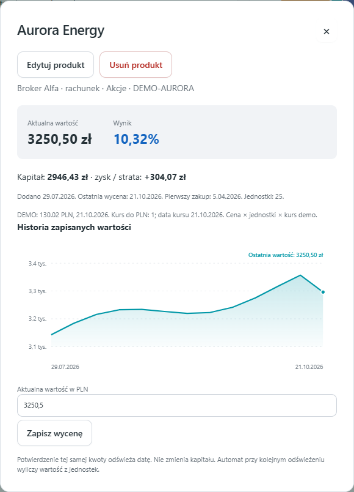
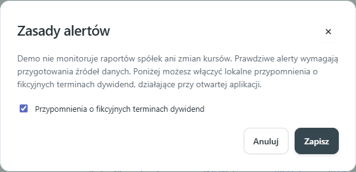

# Instrukcja użytkowania

## Demo a własny portfel

Ta instrukcja opisuje działającą demonstrację. Jeżeli chcesz przejść na własne dane, skorzystaj z [przewodnika dostosowania programu przez Claude Code](WLASNY-PORTFEL.md). Wyjaśnia on usunięcie przykładów, zastąpienie symulacji, integrację EODHD i pierwszy test realnych danych. Nie ma osobnego ekranu wyboru trybów. Prawdziwy portfel wymaga przygotowania Twojej wersji programu, a nie tylko usunięcia przykładowych produktów.

## Pierwsze pięć minut

1. Obejrzyj wartość portfela, wynik PLN i wynik procentowy. Są obliczone z fikcyjnych pozycji.
2. W sekcji Gdzie są Twoje pieniądze przełącz Typy aktywów na Produkty. Słupki są sortowane według wartości, nie liczby jednostek.
3. Wskaż fragment koła lub punkt wykresu, aby zobaczyć etykietę. Możesz też przejść do etykiet klawiaturą.
4. Zmień okres historii. Liniowy wykres nadal przedstawia cały portfel; filtry typu i branży dotyczą podsumowania, słupków, koła i listy.
5. Otwórz alert. Zniknie oznaczenie nieprzeczytania, a licznik w nawigacji się zmniejszy. Wszystkie zdarzenia są oznaczone jako fikcyjne.

## Jak rozpoznać właściwe ekrany

Wszystkie zrzuty pokazują wyłącznie fikcyjne dane. Kwoty i daty mogą się różnić przy kolejnym uruchomieniu.

**Ekran główny.** Baner na górze potwierdza demo. Pod nim są podsumowanie, filtry i wykresy.

**Ustawienia.** Przycisk w nagłówku otwiera symulację, kopie zapasowe danych, reset przykładów i zakończenie programu.

**Szczegóły produktu.** Kliknij nazwę na liście. Tutaj zmieniasz produkt, zapisujesz wycenę albo rozpoczynasz usuwanie wymagające potwierdzenia.

**Zasady alertów.** Monitoring raportów i cen jest opisany jako niedostępny; jedyny przełącznik dotyczy fikcyjnych dywidend.

## Produkty i wyceny

**Dodaj produkt** otwiera formularz. Typ **Portfel zarządzany** oznacza inwestycję prowadzoną przez zewnętrznego zarządzającego. To ogólna kategoria; nie oznacza połączenia z żadnym usługodawcą. Podaj nazwę, typ, konto/miejsce, kapitał i aktualną wartość w PLN. Data pierwszego zakupu jest opcjonalna; nie zastępuje daty dodania do programu. Nieznanej daty nie trzeba zgadywać.

**Kapitał** to kwota zainwestowana w pozycję, a **aktualna wartość** to jej wycena. Przykładowo kapitał 1000 zł i wartość 1100 zł dają zysk 100 zł i wynik 10%. Nie wpisuj obecnej wartości również jako kapitału, jeśli chcesz zachować informację o wcześniejszym zysku lub stracie.

Dla automatycznej symulacji wybierz fikcyjny instrument z katalogu i podaj liczbę jednostek. Własne wpisy spoza katalogu wyceniaj ręcznie. Ten sam instrument na IKE i rachunku zwykłym dodaj jako dwie pozycje, bez dodawania ponownie sumy całego IKE.

**Edytuj** koryguje pola produktu. Po dokupieniu można ręcznie zmienić łączną liczbę jednostek i kapitał, a następnie uruchomić symulację. To korekta stanu, nie zapis transakcji. Nie ma osobnego przycisku Dokup ani księgi zakupów i sprzedaży.

Kliknij nazwę produktu, aby zobaczyć szczegóły, historię oraz formularz **Zapisz wycenę**. Potwierdzenie tej samej kwoty odświeża datę ręcznej wyceny. Samo otwarcie produktu tego nie robi. Po 14 dniach bez ręcznej aktualizacji pojawia się monit; automatyczne symulacje go nie otrzymują.

Usuwanie znajduje się w szczegółach produktu i wymaga osobnego potwierdzenia. Anuluj lub Escape pozostawia dane. Usunięcie produktu nie jest sprzedażą, a wcześniejsze zapisane podsumowania pozostają w historii.

## Aktualizuj wyceny

Przycisk przelicza fikcyjne ceny i przykładowe kursy. Nie wysyła zapytań do giełdy, banku ani dostawcy notowań. Kolejne dni mogą zmieniać ceny; tego samego dnia wynik jest powtarzalny. Wyceny ręczne pozostają pod Twoją kontrolą.

Przykładowa historia od początku ma wiele punktów. Jest syntetyczna. Zmiany wpisane w formularzach dopisują dzisiejszy stan, nie poprawiają wcześniejszych dni wstecz.

## Alerty

Kategorie obejmują raporty kwartalne, terminy raportów, dywidendy oraz ruchy cen. W demo są przygotowane przykładowe rekordy. Nie odbywa się wyszukiwanie nowych rzeczywistych raportów ani nowych wiadomości.

W Zasadach alertów nie ma pól konfiguracji raportów, ruchów cen ani częstotliwości — te funkcje są w demo niedostępne. Demo nie monitoruje rynku; przykłady pozostają w historii. Przełącznik dywidend kontroluje lokalne przypomnienia o zatwierdzonych fikcyjnych terminach w przeddzień lub w dniu zdarzenia.

Dywidendy nie są automatycznie dopisywane do wartości portfela ani uznawane za otrzymane. Propozycja dywidendy i zatwierdzona decyzja mają odrębne znaczenie.

## Eksport do analizy

Otwórz eksport portfela. Możesz skopiować tekst lub pobrać Markdown/JSON. Eksport obejmuje cały portfel, niezależnie od filtrów, i jest oznaczony jako demo. Nie wysyła niczego do ChatGPT, Claude ani innej usługi. Wybierasz samodzielnie, czy i gdzie użyć pobranego pliku.

## Powrót do początku

Aby cofnąć błąd, skorzystaj z wcześniejszej kopii: **Ustawienia → Pokaż kopie do odtworzenia**, wybierz datę i potwierdź. Przywracany jest cały stan; obecny otrzymuje kopię. [Instrukcja backupów i odtwarzania](KOPIE-ZAPASOWE.md).

W Ustawieniach wybierz **Przywróć dane demonstracyjne** i potwierdź. Zastąpi to zmiany w demo nowym fikcyjnym portfelem. Wcześniejszy stan otrzymuje szyfrowaną kopię. Nie usuwa to danych innych aplikacji.
