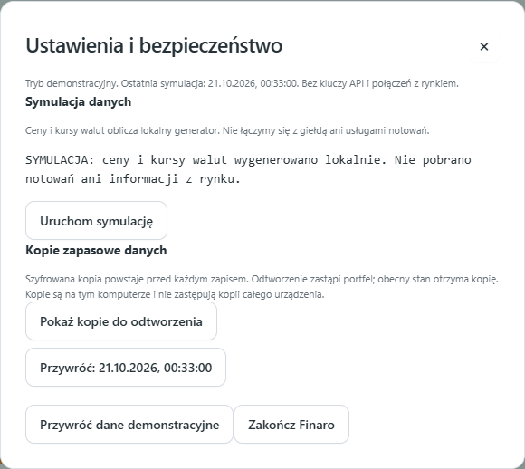

# Kopie zapasowe i przywracanie danych

## Kiedy powstaje kopia?

Nie musisz ręcznie klikać Zrób backup. Przed zastąpieniem zapisanego portfela aplikacja zachowuje jego poprzedni stan. Dotyczy to m.in. edycji, ręcznej wyceny, usuwania, zapisu symulacji ze zmianami oraz resetu demo. Ponowna symulacja bez zmiany cen, historii ani przypomnień nie zapisuje pliku i nie tworzy kolejnej kopii. Pierwszy zapis tworzy dopiero plik danych; nie ma jeszcze wcześniejszego stanu do skopiowania.

Jeśli pomylisz kwotę lub usuniesz pozycję, wcześniejsza kopia może pozwolić wrócić do stanu sprzed tej zmiany. Kopia zawiera cały stan portfela, historię, alerty i ustawienia zapisane razem z nim. Nie jest kopią kodu aplikacji.

## Gdzie są dane?

- Bieżący portfel: **%LOCALAPPDATA%\FinaroDemo\demo-v1\portfolio.enc**.
- Kopie: folder **backups** w tym samym katalogu.
- Pliki są szyfrowane ochroną konta Windows, które je zapisało.

Nie musisz otwierać tych plików ani przenosić ich do katalogu aplikacji. Ich nazwy zawierają czas utworzenia i unikalny identyfikator. W interfejsie wybierasz kopię według daty i godziny.

## Jak przywrócić kopię krok po kroku

1. Otwórz Finaro demo i wejdź w **Ustawienia**.
2. Kliknij **Pokaż kopie do odtworzenia**.
3. Wybierz kopię z czasu sprzed niepożądanej zmiany.
4. Przeczytaj potwierdzenie i zaakceptuj przywrócenie.
5. Sprawdź pozycje, wartości i historię po odtworzeniu.

Przywrócenie zastępuje **cały stan portfela**, a nie jeden produkt. Nowsze edycje znikną z bieżącego widoku. Przed zastąpieniem obecny stan również otrzymuje kopię, więc można później wrócić do niego tą samą drogą. Anulowanie potwierdzenia nie zmienia danych.

Jeżeli masz kilka otwartych kart, odśwież je przed dalszą edycją. Stary formularz nie powinien nadpisywać odtworzonego stanu.

## Przywrócenie kopii a reset demo

**Kopia zapasowa danych** odtwarza wcześniejsze zapisane zmiany. **Przywróć dane demonstracyjne** generuje początkowy fikcyjny portfel z datami przesuniętymi do bieżącego dnia. Reset również zachowuje kopię poprzedniego stanu. To dwie różne czynności.

Eksport Markdown/JSON służy zestawieniu do analizy. Nie zawiera całego stanu aplikacji i nie zastępuje mechanizmu odtwarzania kopii.

## Co w razie uszkodzenia pliku?

Gdy aplikacja nie może odczytać lub zweryfikować portfela, blokuje zwykły zapis i proponuje odtworzenie kopii. Nie powinna po cichu zastąpić danych pustym lub początkowym portfelem. Nie kasuj ręcznie plików, zanim sprawdzisz możliwość odzyskania.

## Ochrona przed awarią komputera

Automatyczne kopie na tym samym dysku pomagają cofać pomyłki, ale nie zabezpieczają przed utratą całego urządzenia. Korzystaj także z niezależnej kopii urządzenia/profilu Windows. Samo przeniesienie pliku .enc na inne konto lub komputer nie zapewnia jego odszyfrowania. To ograniczenie zastosowanej ochrony konta Windows.

Kopie nie są w tej wersji automatycznie usuwane ani wysyłane poza komputer. Mogą z czasem zajmować więcej miejsca. Nie dodawaj ich do GitHuba i nie wysyłaj ich asystentowi AI. Więcej o rozdzieleniu kodu i danych: [PRYWATNOSC.md](PRYWATNOSC.md).
